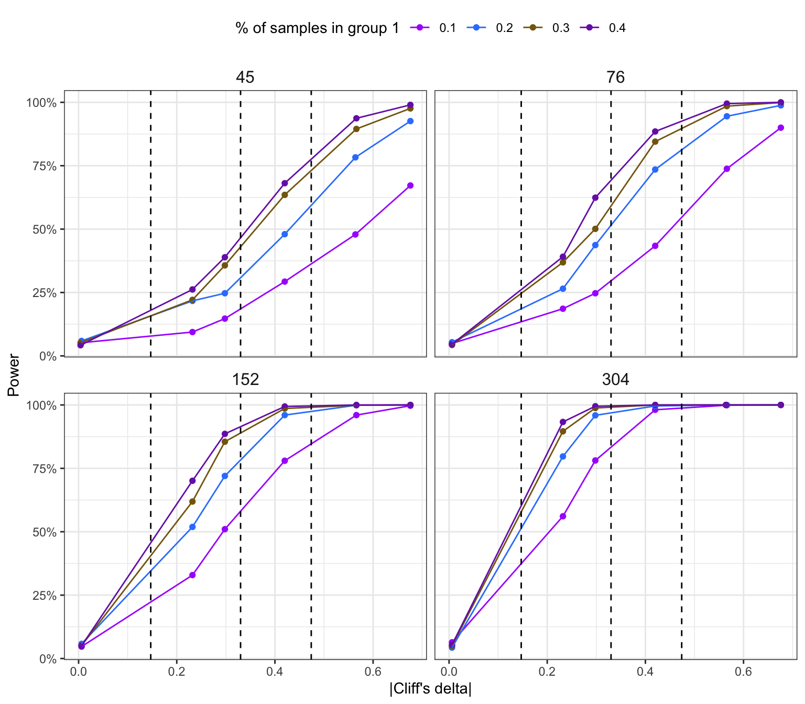

```{r}
#| label: setup

library(tidyverse)
library(fitdistrplus)

theme_set(theme_bw() + theme(strip.background = element_blank()))

outcome <- rgamma(400, 1.5, .4)

df <- tibble(outcome)

```


I learned about the Wilcox test when analyzing single-cell data; and always thought that it was the test to use whenever a parametric test didn't work, then the next thing was to try and use Wilcox. Because of this, I never took the time to learn the hypothesis that we were testing for, or how to compute the power for that test.

## Wilcox rank-sum test

For this test, we observe two groups of iid random variables $X_1, \cdots, X_n \sim F_X$ and iid random variables $Y_1,\cdots, Y_m \sim F_Y$, each with their own distribution, the random variables in one list are independent of the others, and typically $n\neq m$. The hypothesis we want to test is:

$$H_0: P(X < Y) = P(X>Y)$$
To test the hypothesis, we need to compute the $U$ statistic, which is done by gathering the $X$ and $Y$ samples together into a list of random variables $Z_1, Z_2, \cdots, Z_n, Z_{n+1},\cdots, Z_{n+m}$, which are then ranked together. Then, we compute the sum of the ranks of the $X$ random variables, and the same for the $Y$ random variables, we define those quantities as $R_1$ and $R_2$, respectively. Then, we use the $U$ statistic defined as:

$$
\begin{aligned}
U &= \min (U_1 , U_2 ) \\
U_1 &= n \cdot m - \frac{(n)(n+1)}{2} - R_1 \\
U_2 &= n \cdot m - \frac{(m)(m+1)}{2} - R_2 \\
\end{aligned}
$$

The test is rarely solved manually, and can be computed using the `wilcox.test` function in R. Alternatively, we can use `rstatix::wilcox_test` that basically does the same but using a tidy format.

### Computing the power via montecarlo simulations

For a continuous outcome, we can use the `wmwpow` R package [@Mollan2020-kb]. This R package provides three alternatives to compute the power via simulations. Since I wanted to have the most control in my simulations, I used the `wmwpowd` function which computes the power given strings representing the simulating distributions $F_X$ and $F_Y$:

```R
wmwpowd(n, m, distn, distm, sides, alpha = 0.05, nsims = 10000)
```

where:

- `n`, `m` are the sample sizes of $X$ and $Y$, respectively
- `distn`, `distm` are the $F_X$, $F_Y$ distributions; and use a syntax based on R's simulation, e.g. `norm(0, 1)` would simulate from a $N(0,1)$ and the syntax is based on the `rnorm`, `qnorm`, `pnorm`, etc.
- `sides` configures the side of the alternative hypothesis 
- `alpha` is the significance of the test 
- `nsims` is the # of simulations

My goal was to study the power of tests where the sample size $n + m$ was fixed and there could be an imbalance between the group sizes $n$ and $m$. Without loss of generality (using a two-sided test), we can say that $n = \lfloor q \cdot (n + m) \rfloor$. 

The first step is to define the distributions, for which I used the `fitdistrplus` R package [@DelignetteMuller2015-gy] to fit a Gamma distribution to my outcome variable.

```{r}
#| label: fig-outcome
#| include: true
#| echo: true
#| fig-width: 6
#| fig-height: 4
#| out-width: "55%"
#| fig-cap: "outcome distribution"

gamma_fit <- fitdistrplus::fitdist(df$outcome, "gamma")

df |>
  ggplot(aes(x = outcome)) +
    geom_histogram(aes(y = after_stat(density)), bins = 21,
      fill = "white", colour = "black") + 
    stat_function(
      fun = dgamma,
      args = list(shape = gamma_fit$estimate["shape"],
        rate = gamma_fit$estimate["rate"]),
      color = "firebrick",
      linewidth = 1.2)


```

and using that distribution as baseline, I varied the shape parameter:

```{r}
#| label: fig-distr
#| include: true
#| echo: false
#| fig-width: 6
#| fig-height: 4
#| out-width: "55%"
#| fig-cap: "example for two distributions for X and Y"

df |>
  ggplot(aes(x = outcome)) +
    stat_function(
      fun = dgamma,
      args = list(shape = gamma_fit$estimate["shape"],
        rate = gamma_fit$estimate["rate"]),
      color = "firebrick",
      linewidth = 1.2) +
    stat_function(
      fun = dgamma,
      args = list(shape = 3,
        rate = gamma_fit$estimate["rate"]),
      color = "steelblue",
      linewidth = 1.2) +
    theme_classic() +
    theme(
      axis.title.y = element_blank(),
      axis.text.y = element_blank(),
      axis.ticks.y = element_blank())

```

Repeating this framework for multiple sample sizes, and different sampling proportions $q$ (which are the panel titles and colors in @fig-power, respectively). We were able to quantify the power. The power figure typically uses $p=P(Y>X)$ in the x-axis, but since we also cared about the effect sizes, I used Cliff's delta which is defined as $\delta=1 - 2p$, and there are thresholds (the dashed lines in the figure below) that can be used to categorize the effect sizes:

- Negligible: $|\delta|< 0.147$
- Small: $0.147 \leq |\delta| < 0.33$
- Medium: $0.33 \leq |\delta | < 0.474$
- Large: $|\delta| \geq 0.474$

@fig-power indicates that the statistical power of using Wilcoxon rank-sum tests is small when either a) the sample size is small or b) the groups are the most imbalanced.


```{r}
#| label: "fig-power"
#| include: true
#| out-width: "75%"
#| fig-cap: "Statistical power for Wilcox rank-sum test, with varying sample size per group"



```


### Extra 

Using the R package [targets](https://books.ropensci.org/targets/), to have a reproducible pipeline to make this:

```{r}
#| label: targets-pow
#| include: true
#| echo: true
#| eval: false

library(targets)

tar_source(here::here("R"))

tar_option_set(
  packages =
    c(
      "tidyverse",
      "fitdistrplus",
      "rstatix",
      "fitdistrplus",
      "wmwpow"
    ),
  format = "qs")


list(
  # power analysis
  tar_target(
    gamma_fit,
    fitdistrplus::fitdist(outcome, "gamma")),
  tar_target(
    gammastr1, glue::glue("gamma({shape}, {rate})",
    shape = gamma_fit$estimate["shape"],
    rate = gamma_fit$estimate["rate"])),
  tar_target(
    sample_prop, seq(.05, .45, by = .05)),
  tar_target(
    nsamples, nrow(cleandata)),
  tar_target(
    psamples, floor(c(.15, .25, .5, 1) * nsamples)),
  tar_target(
    gamma_shapes, seq(1, 5, by = .5)),
  tar_target(
    gammastr2,
    glue::glue("gamma({shape},{rate})",
    shape = gamma_shapes, rate = gamma_fit$estimate["rate"])),  
  tar_target(
    power,
    wmwpow::wmwpowd(floor(psamples * sample_prop),
      floor(psamples * (1 - sample_prop)),
        distn = as.character(gammastr1),
        distm = as.character(gammastr2),
          sides = "two.sided", alpha = 0.05, nsims = 1e3),
    pattern = cross(sample_prop, gammastr2, psamples)),
  tar_target(
    df,
    tibble(sample_prop, gammastr2, psamples) |>
        mutate(zz = psamples / nsamples),
    pattern = cross(sample_prop, gammastr2, psamples)),    
  tar_target(
    pwr_df,
    tibble(
      pwr = power["empirical_power"][[1]],
      alpha = power["alpha"][[1]],
      p = power["p"][[1]],
      n = power["n"][[1]],
      m = power["m"][[1]],
      wmw_odds = power["wmw_odds"][[1]],
      distn = power["distn"][[1]],
      distm = power["distm"][[1]]) |>
    mutate(
      delta = 1 - 2 * p, 
      shapem = str_split_i(distm, ",", 1),
      shapem = str_remove(shapem, "gamma\\("),
      shapem = as.numeric(shapem)),
    pattern = map(power))
)

```